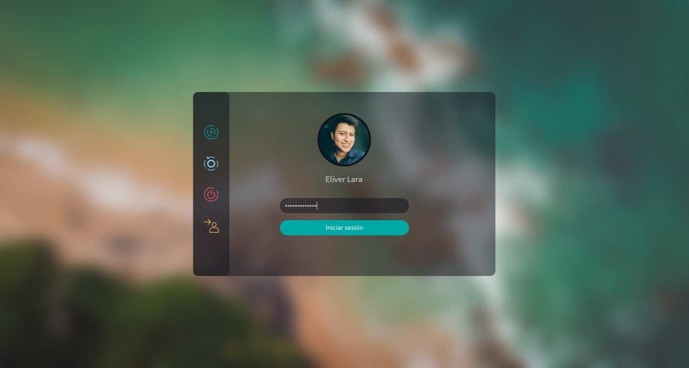

# Ocean-P6

Ocean-themed SDDM login theme for KDE Plasma 6, adapted for Plasma 6.8 / Qt 6.



> The preview image is from the original theme; actual rendering depends on the user, language, avatar, and system state.

- **Original theme**: [Eliver Lara — Juno / Ocean-P6](https://github.com/EliverLara/Juno/tree/ocean/kde/sddm/Ocean-P6)
- **License**: GPL-3.0-or-later (see [LICENSE](LICENSE))
- **Plasma 6.8 adaptation notes**: [PLASMA_6.8_ADAPTATION.md](PLASMA_6.8_ADAPTATION.md)

[中文](#中文) | [English](#english)

---

## 中文

### 简介

Ocean-P6 是面向 KDE Plasma 6 的 SDDM 登录主题，保留 Ocean 的青色强调色、深色半透明面板、背景模糊与整体布局。本项目已完成 Plasma 6.8 / Qt 6 适配：

- 虚拟键盘迁移到 `org.kde.plasma.workspace.keyboardlayout` 的 `KWinVirtualKeyboard`
- Caps Lock 使用 `org.kde.plasma.private.keyboardindicator`
- 支持图片/纯色背景、无密码账户、认证期间防重复提交与失败焦点恢复
- 统一使用 `plasma-desktop-sddm-theme` 翻译域

### 兼容性

| 项目 | 版本 |
|---|---|
| KDE Plasma | 6.8.2（测试） |
| Qt | 6.11.2（测试） |
| SDDM | 0.21+（`sddm-greeter-qt6`） |

不支持 Plasma 5 / Qt 5。

### 安装

脚本执行系统级安装，需要 sudo：

```bash
chmod +x install.sh uninstall.sh
sudo ./install.sh
```

- 安装目录：`/usr/share/sddm/themes/Ocean-P6`
- 已存在的 `theme.conf.user` 会被保留
- 不会修改当前 SDDM 主题，也不会重启 SDDM
- 重复运行会覆盖主题文件，但保留用户配置

> SDDM 默认只读取 `/usr/share/sddm/themes`（`[Theme] ThemeDir`），不会自动读取用户主目录下的主题。

### 预览

安装后先测试，再切换：

```bash
sddm-greeter-qt6 --test-mode --theme /usr/share/sddm/themes/Ocean-P6
QT_QUICK_BACKEND=software sddm-greeter-qt6 --test-mode --theme /usr/share/sddm/themes/Ocean-P6
```

- 测试模式中的电源按钮可能显示为禁用态，这是 `sddm.canSuspend/canReboot/canPowerOff` 的测试环境状态，真实 greeter 会按系统策略显示。
- 使用 `Ctrl+C` 结束测试。

### 启用

推荐通过系统设置：

**系统设置 → 颜色与主题 → 登录屏幕（SDDM）→ 选择 Ocean-P6**

也可以编辑 `/etc/sddm.conf.d/kde_settings.conf`：

```ini
[Theme]
Current=Ocean-P6
```

- 保存工作后注销验证，不要在未保存工作时重启显示管理器。
- 建议保留 Breeze 或 Lavanda 作为备用主题。

### 配置

`theme.conf` 默认值：

| 键 | 默认值 | 说明 |
|---|---|---|
| `type` | `image` | `image` 或 `color` |
| `background` | `assets/bg.jpg` | 图片背景；相对路径基于主题目录 |
| `background_color` | `#0F111A` | `type=color` 时的背景色 |
| `color` | `#C3C7D1` | 常规文字颜色 |
| `highlight_color` | `#fefefe` | 高亮文字/按钮文字 |
| `selected_color` | `#00A9A5` | 强调色/登录按钮 |
| `selected_fg_color` | `#fefefe` | 强调色前景 |
| `fontSize` | `11.5` | 字号 |
| `font` | `Cantarell` | 字体 |

- 旧配置键 `Background` 仍然兼容。
- `theme.conf.user` 会覆盖 `theme.conf`；安装时保留，卸载时删除。

### 卸载

```bash
sudo ./uninstall.sh
# 非交互
sudo ./uninstall.sh --yes
```

- 如果当前 SDDM 主题是 Ocean-P6，脚本会拒绝卸载；请先在系统设置中切换到其他主题。
- 不会修改 SDDM 配置，不会重启 SDDM。

### 目录结构

```
Main.qml                   主题根组件
Login.qml                  登录表单
Background.qml             图片/纯色背景
KeyboardButton.qml         键盘布局按钮
SessionButton.qml          会话选择按钮
components/                用户列表、时钟、电池、输入框等
assets/                    背景与图标
faces/                     默认头像
theme.conf                 主题默认配置
metadata.desktop           主题元数据
preview.png                预览图
install.sh                 系统级安装脚本
uninstall.sh               系统级卸载脚本
PLASMA_6.8_ADAPTATION.md   Plasma 6.8 适配与验证记录
```

### 故障排查

- **回退到内嵌主题**：运行测试模式查看 QML 错误；服务日志可用 `journalctl -b | grep sddm-greeter`。确认 `/usr/share/sddm/themes/Ocean-P6` 可被 `sddm` 用户读取（安装脚本设置为 `root:root`、`a+rX`）。
- **没有虚拟键盘按钮**：`KWinVirtualKeyboard.available` 为 false 时按钮隐藏，需要 KWin 虚拟键盘支持。
- **软件渲染**：为性能关闭全屏模糊，头像使用 Breeze 的方形回退，属于预期行为。
- **qmllint**：需要 Qt 6 版本；Qt 5 的 `qmllint` 无法解析 `?.` / `??`。
- **不要通过 SSH 重启 SDDM**：在本地控制台验证，并保留可用的备用主题。

### 许可与致谢

- 原始主题：Eliver Lara，Juno / Ocean-P6，GPL-3.0-or-later。
- 来源：https://github.com/EliverLara/Juno/tree/ocean/kde/sddm/Ocean-P6
- Plasma 6.8 适配与安装脚本：本项目。
- 本主题按 GPL 分发，不提供担保。

---

## English

### Overview

Ocean-P6 is an SDDM login theme for KDE Plasma 6. It preserves Ocean's teal accent color, dark translucent panel, blurred background, and overall layout. This project is adapted for Plasma 6.8 / Qt 6:

- Virtual keyboard migrated to `KWinVirtualKeyboard` from `org.kde.plasma.workspace.keyboardlayout`
- Caps Lock uses `org.kde.plasma.private.keyboardindicator`
- Image/color backgrounds, passwordless accounts, duplicate-submit protection, and focus recovery
- Translations use the `plasma-desktop-sddm-theme` domain

### Compatibility

| Item | Version |
|---|---|
| KDE Plasma | 6.8.2 (tested) |
| Qt | 6.11.2 (tested) |
| SDDM | 0.21+ (`sddm-greeter-qt6`) |

Plasma 5 / Qt 5 are not supported.

### Installation

The script performs a system-wide installation and requires sudo:

```bash
chmod +x install.sh uninstall.sh
sudo ./install.sh
```

- Target: `/usr/share/sddm/themes/Ocean-P6`
- An existing `theme.conf.user` is preserved
- The current SDDM theme is not changed and SDDM is not restarted
- Re-running overwrites theme files but keeps user configuration

> SDDM reads `/usr/share/sddm/themes` by default (`[Theme] ThemeDir`); it does not automatically read theme directories inside user homes.

### Preview

Test before selecting the theme:

```bash
sddm-greeter-qt6 --test-mode --theme /usr/share/sddm/themes/Ocean-P6
QT_QUICK_BACKEND=software sddm-greeter-qt6 --test-mode --theme /usr/share/sddm/themes/Ocean-P6
```

- In test mode, power buttons may appear disabled because `sddm.canSuspend/canReboot/canPowerOff` reflect the test environment; a real greeter follows system policy.
- Press `Ctrl+C` to stop the test.

### Enabling

Recommended: **System Settings → Colors & Themes → Login Screen (SDDM) → Ocean-P6**.

Alternatively, edit `/etc/sddm.conf.d/kde_settings.conf`:

```ini
[Theme]
Current=Ocean-P6
```

- Save your work, then log out to verify. Do not restart the display manager with unsaved work.
- Keep Breeze or Lavanda as a fallback theme.

### Configuration

`theme.conf` defaults:

| Key | Default | Description |
|---|---|---|
| `type` | `image` | `image` or `color` |
| `background` | `assets/bg.jpg` | Image background; relative to the theme directory |
| `background_color` | `#0F111A` | Background color when `type=color` |
| `color` | `#C3C7D1` | Normal text color |
| `highlight_color` | `#fefefe` | Highlighted/button text |
| `selected_color` | `#00A9A5` | Accent color / login button |
| `selected_fg_color` | `#fefefe` | Accent foreground |
| `fontSize` | `11.5` | Font size |
| `font` | `Cantarell` | Font family |

- The legacy `Background` key remains supported.
- `theme.conf.user` overrides `theme.conf`; it is preserved by the installer and removed by the uninstaller.

### Uninstall

```bash
sudo ./uninstall.sh
# non-interactive
sudo ./uninstall.sh --yes
```

- If Ocean-P6 is the current SDDM theme, the script refuses to remove it. Switch to another theme in System Settings first.
- SDDM configuration is not modified and SDDM is not restarted.

### Project layout

```
Main.qml                   Theme root
Login.qml                  Login form
Background.qml             Image/color background
KeyboardButton.qml         Keyboard layout button
SessionButton.qml          Session selector
components/                User list, clock, battery, inputs, etc.
assets/                    Background and icons
faces/                     Default avatar
theme.conf                 Default theme configuration
metadata.desktop           Theme metadata
preview.png                Preview image
install.sh                 System-wide installer
uninstall.sh               System-wide uninstaller
PLASMA_6.8_ADAPTATION.md   Plasma 6.8 adaptation and verification notes
```

### Troubleshooting

- **Fallback to embedded theme**: run test mode to see QML errors; service logs are available via `journalctl -b | grep sddm-greeter`. Ensure `/usr/share/sddm/themes/Ocean-P6` is readable by the `sddm` user (the installer sets `root:root` and `a+rX`).
- **No virtual keyboard button**: the button is hidden when `KWinVirtualKeyboard.available` is false; KWin virtual keyboard support is required.
- **Software rendering**: the full-screen blur is disabled for performance and the avatar uses Breeze's square fallback; this is expected.
- **qmllint**: use the Qt 6 tool; Qt 5 `qmllint` cannot parse `?.` / `??`.
- **Do not restart SDDM over SSH**: verify locally and keep a working fallback theme.

### License and credits

- Original theme: Eliver Lara, Juno / Ocean-P6, GPL-3.0-or-later.
- Source: https://github.com/EliverLara/Juno/tree/ocean/kde/sddm/Ocean-P6
- Plasma 6.8 adaptation and installation scripts: this project.
- Distributed under the GPL, without warranty.
